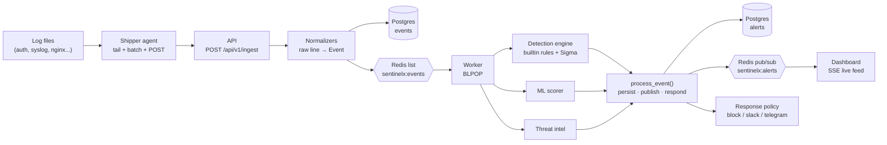

# SentinelX


**SentinelX is a mini SOC platform that ingests real log streams, detects attacks with Sigma + heuristic rules and ML anomaly scoring, enriches alerts with threat intelligence, and responds automatically — all running in one `docker compose` stack.**

Most SIEM tutorials stop at "send logs to a dashboard". SentinelX closes the loop: a shipper agent tails logs on monitored hosts, the API normalizes them into a shared event contract, a worker pipeline runs detection rules, ML models, and threat-intel enrichment over every event, alerts land in Postgres and stream live to the dashboard over SSE, and a YAML response policy decides whether to block the attacker and page you. It also ships a deliberately vulnerable Flask target so you can attack your own lab and watch the pipeline fire end to end.

## Features

- **Log shipper agent** — tails auth/syslog/web logs with rotation handling, batches, and POSTs with backoff retries.
- **Normalization engine** — parses syslog (RFC3164), OpenSSH auth, nginx/Apache combined, Windows Security JSON (4624/4625/4672/4720), and netflow (JSON/CSV) into one `Event` contract.
- **Detection engine** — 4 builtin Python rules plus a bundled mini Sigma compiler with 8 Sigma rules; rules are stateless and windowed correlation lives in Redis.
- **ML anomaly detection** — Isolation Forest + autoencoder scoring (login and traffic feature paths), with a standalone `ml-anomaly` alert when nothing else fires.
- **Threat intel enrichment** — AbuseIPDB, VirusTotal, and OTX verdicts with 24h caching; score boost raises severity. Mock mode for offline work.
- **Automated response** — YAML policy: iptables block for critical alerts, Slack/Telegram notifications; dry-run by default.
- **React SOC dashboard** — overview stats, alerts table, timeline, top attackers, and a live alert feed over server-sent events.
- **Attack lab** — intentionally vulnerable Flask target (SQLi, reflected XSS, weak creds) behind a `lab` compose profile.

## Architecture



Full component breakdown, the Redis key inventory, and the DB schema: [docs/01-architecture.md](docs/01-architecture.md).

## Quickstart

Prerequisites: Docker + Docker Compose, and Python 3.11 for local agent/test runs.

```bash
# 1. Get the repo
git clone <repository-url>
cd sentinelx

# 2. Configure (never commit a real .env)
cp .env.example .env

# 3. Start the stack: postgres, redis, api, worker, dashboard
docker compose up --build

# 4. Open the dashboard and check the API
#    dashboard → http://localhost
#    health    → http://localhost:8000/healthz
```

Ship some events and watch the pipeline:

```bash
# Tail the pipeline as it works
docker compose logs -f worker api

# Ship a few auth lines (from the repo root, needs the python deps installed)
python -m sentinelx.agent --config agents/shipper/agent.example.yml
```

### Attack lab demo

The stack includes an intentionally vulnerable target (SQL injection, reflected XSS, weak credentials) behind the `lab` profile:

```bash
# Start the target on :5000 (HTTP) and :2222 (SSH)
docker compose --profile lab up -d target

# Hit it with attack traffic, e.g. SQLi probe:
curl "http://localhost:5000/search?q=' UNION SELECT * FROM users--"
```

Point the shipper (or curl `POST /api/v1/ingest`) at the target's web logs and watch `SX-WEB-ATTACK` alerts land in the dashboard and fire the response policy. The full walkthrough — every attack, the expected detections, and what to screenshot — is in [docs/10-lab-guide.md](docs/10-lab-guide.md).

## Detection coverage

| Attack | Rule ID | MITRE | Severity |
|--------|---------|-------|----------|
| SSH brute force (5+ failed logins / 300s per IP) | `SX-BRUTE-FORCE` | T1110.001 — Brute Force: Password Guessing | high |
| Failed root SSH login | `ssh_failed_root_login` (Sigma) | T1110.001 — Brute Force: Password Guessing | high |
| Failed password auth (any source) | `auth_failed_password` (Sigma) | T1110.001 — Brute Force: Password Guessing | low |
| Windows failed logon (4625) | `windows_failed_logon_4625` (Sigma) | T1110.001 — Brute Force: Password Guessing | medium |
| Port scan (15+ distinct ports / 60s per IP) | `SX-PORT-SCAN` | T1046 — Network Service Discovery | medium |
| SQL injection probe | `SX-WEB-ATTACK` | T1190 — Exploit Public-Facing Application | high |
| SQL injection probe (Sigma) | `web_sqli_probe` (Sigma) | T1190 — Exploit Public-Facing Application | high |
| XSS probe | `web_xss_probe` (Sigma) | T1190 — Exploit Public-Facing Application | medium |
| Path traversal probe | `web_path_traversal` (Sigma) | T1190 — Exploit Public-Facing Application | medium |
| Privilege escalation (interactive root shell via sudo/su, Windows 4672, `privilege_escalation` action) | `SX-PRIV-ESC` | T1068 — Exploitation for Privilege Escalation | critical |
| Sudo to root shell (Sigma) | `sudo_to_root_shell` (Sigma) | T1068 — Exploitation for Privilege Escalation | high |
| Anomalous login/web traffic (ML score ≥ 0.7, no rule hit) | `ml-anomaly` | T1078 — Valid Accounts | medium |
| New Windows user account (4720) | `windows_new_user_4720` (Sigma) | T1078 — Valid Accounts | medium |

Severity is always derived from the alert's numeric score (`score_to_level()`), so the two can never drift apart. Intel verdicts add a score boost that can push an alert into a higher severity.

## Repository structure

```
.
├── agents/shipper/agent.example.yml   # agent config template
├── dashboard/                         # React + Vite + TS SOC dashboard (served on :80)
├── docker-compose.yml                 # postgres, redis, api, worker, dashboard (+ lab target)
├── docs/                              # 01-architecture.md … 11-api-reference.md
├── lab/target/                        # intentionally vulnerable Flask lab target
├── policies/policy.yaml               # automated response policy
├── services/                          # Dockerfiles for api and worker
├── src/
│   ├── requirements.txt
│   └── sentinelx/
│       ├── agent/        # log shipper (tail -F, batch, POST)
│       ├── api/          # FastAPI: ingest, alerts, stats, SSE stream, healthz
│       ├── common/       # Event/Alert contracts, MITRE table, severity helpers
│       ├── detection/    # engine, 4 builtin rules, Sigma compiler, 8 Sigma rules
│       ├── ingestion/    # log normalizers (syslog/auth/nginx/apache/windows/netflow)
│       ├── intel/        # AbuseIPDB, VirusTotal, OTX enrichment + caching
│       ├── ml/           # features, models, scoring, training scripts
│       ├── response/     # policy engine, iptables blocker, slack/telegram
│       └── worker/       # Redis consumer + six-stage processing pipeline
└── tests/                             # pytest suite (11 files)
```

## Configuration

All runtime config comes from `.env` (see `.env.example`). Marked 🔑 = secret — never commit a real value.

| Variable | Default | Description |
|----------|---------|-------------|
| `SENTINELX_ENV` | `dev` | Environment name |
| `DATABASE_URL` 🔑 | `sqlite:///./sentinelx.db` | SQLAlchemy URL (compose overrides to Postgres) |
| `REDIS_URL` | `redis://redis:6379/0` | Redis for queue/state/pubsub/intel cache |
| `ABUSEIPDB_API_KEY` 🔑 | — | Threat-intel provider; empty = skipped |
| `VIRUSTOTAL_API_KEY` 🔑 | — | Threat-intel provider; empty = skipped |
| `OTX_API_KEY` 🔑 | — | Threat-intel provider; empty = skipped |
| `SENTINELX_INTEL_MOCK` | `1` | `1` = deterministic offline intel fixture, no network calls |
| `SENTINELX_DRY_RUN` | `1` | `1` = log response actions only; `0` = really run iptables |
| `SLACK_WEBHOOK_URL` 🔑 | — | Notification webhook; empty = skipped |
| `TELEGRAM_BOT_TOKEN` 🔑 | — | Telegram notifier; empty = skipped |
| `TELEGRAM_CHAT_ID` 🔑 | — | Telegram destination chat |
| `VITE_API_URL` | `http://localhost:8000` | API base URL baked into the dashboard |

Operational overrides: `SENTINELX_SIGMA_DIR` (extra Sigma rules), `SENTINELX_POLICY_PATH` (response policy), `SENTINELX_MODEL_DIR` (ML models). Behavior when things are missing is documented in [docs/01-architecture.md](docs/01-architecture.md#failure-modes) — every stage degrades to a logged warning instead of crashing.

## Screenshots

No screenshots are checked in — run the stack, start the lab target, and capture your own dashboard, live feed, and alert detail views. [docs/10-lab-guide.md](docs/10-lab-guide.md) lists exactly what to capture (dashboard mid-attack, alert detail, timeline spike). If you add them, keep them under `docs/images/`.

## Roadmap

- **Sigma backend completeness** — more Sigma modifiers and aggregation conditions so more upstream rules compile as-is.
- **eBPF agent** — a second shipper using eBPF for process/network telemetry alongside file tailing.
- **Alert correlation** — group related alerts (same attacker, same host) into incidents instead of isolated rows.
- **Playbook actions** — extend the response policy beyond block/notify (e.g. isolate host, capture forensic snapshot).

## Disclaimer

**For education and lab use only. The lab target is intentionally vulnerable — never expose it.** Run it only on isolated lab networks; the credentials, SQL injection, and XSS flaws in `lab/target/` are there to be attacked by you, not by the internet.

## License

MIT — see [LICENSE](LICENSE).
