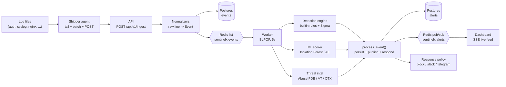

# Architecture

How SentinelX fits together: the components, the data path from a raw log
line to a response action, and the contracts (Redis keys, DB schema) that
hold the pieces together.

Component deep dives live in `02-ingestion.md` … `11-api-reference.md`;
this doc is the map.

## Components

| Component | Code | Role |
|-----------|------|------|
| Shipper agent | `src/sentinelx/agent/shipper.py` | Tails log files on a monitored host (`tail -F` semantics with rotation handling), batches lines, and POSTs them to the API with exponential-backoff retries. Configured via `agents/shipper/agent.example.yml`. |
| API | `src/sentinelx/api/main.py` | FastAPI service. `POST /api/v1/ingest` normalizes raw lines into the shared `Event` contract, stores them in Postgres, and pushes each onto the `sentinelx:events` Redis list. Also serves alerts/stats/attackers and a server-sent-events stream of new alerts. |
| Worker | `src/sentinelx/worker/run.py` + `pipeline.py` | `BLPOP`s events off `sentinelx:events` (5s timeout), runs each through the six-stage pipeline, and shuts down gracefully on SIGINT/SIGTERM. Retries every 5s when Redis is unreachable instead of crashing. |
| Detection engine | `src/sentinelx/detection/` | 4 builtin Python rules (`rules/*.py`) plus a mini Sigma compiler (`sigma.py` + `sigma_rules/*.yml`). Rules are stateless; temporal correlation goes through the windowed-state helper `RedisState`. A rule that raises is logged and skipped, never blocking the pipeline. |
| ML scorer | `src/sentinelx/ml/scoring.py` | Per-event anomaly score in `[0, 1]` from Isolation Forest / autoencoder models (login and traffic feature paths). No models → returns `0.0`. Scores ≥ 0.7 with no rule hit produce a standalone `ml-anomaly` alert (T1078, medium). |
| Threat intel | `src/sentinelx/intel/enrich.py` | Enriches the event's public `src_ip` via AbuseIPDB, VirusTotal and OTX (24h Redis cache, 24h in-process cache), returning a `boost` added to the alert score. Missing API keys → provider skipped; `SENTINELX_INTEL_MOCK=1` → deterministic fixture. |
| Response policy | `src/sentinelx/response/policy.py` | YAML-driven actions from `policies/policy.yaml`: iptables `block` for critical alerts, `slack`/`telegram` notifications. `SENTINELX_DRY_RUN=1` (default) logs actions instead of executing them. |
| Dashboard | `dashboard/` | React (Vite + TypeScript) single-page SOC dashboard: overview stats, alerts table, timeline, top attackers, and a live alert feed over SSE. |
| Postgres | `docker-compose.yml` | Durable store for normalized events (`events` table) and alerts (`alerts` table). |
| Redis | `docker-compose.yml` | The nervous system: event queue, detection state, pub/sub alerts, intel cache. Append-only persistence (`--appendonly yes`). |

## End-to-end data flow

```
log line on a host
  │
  ▼  agent: FileTailer.read_new() -> Shipper.send_batch()
POST /api/v1/ingest {host, source, lines}
  │
  ├─► normalize() -> Event (shared pydantic contract)
  ├─► INSERT INTO events (Postgres)
  └─► RPUSH sentinelx:events (Redis list)
        │
        ▼  worker: BLPOP sentinelx:events (timeout 5s)
  ┌─────────────────────────────────────────────┐
  │ process_event()                             │
  │  1. rules   -> alerts (windowed state via   │
  │     RedisState; missing engine -> skipped)  │
  │  2. ML      -> ml_score on each alert, or a │
  │     standalone ml-anomaly alert (>= 0.7)    │
  │  3. intel   -> boost -> compute_score() ->  │
  │     score_to_level() (public src_ip only)   │
  │  4. persist -> INSERT INTO alerts           │
  │  5. publish -> PUBLISH sentinelx:alerts     │
  │  6. respond -> policy.act(alert)            │
  └─────────────────────────────────────────────┘
        │
        ├─► dashboard: GET /api/v1/stream (SSE, subscribed to sentinelx:alerts)
        └─► response: block via iptables / slack / telegram (or dry-run log)
```

Every stage is defensive: a missing Redis, detection package, ML models, or
intel keys degrades to a logged warning rather than a crash (see
[Failure modes](#failure-modes)).

## Mermaid diagram



## Redis key inventory

| Key | Type | Written by | Read by | Notes |
|-----|------|------------|---------|-------|
| `sentinelx:events` | list | API (`RPUSH`) | worker (`BLPOP`, 5s timeout) | The event queue. When Redis is down, the API skips queuing with a warning and events only land in Postgres. |
| `sentinelx:alerts` | pub/sub channel | worker (`PUBLISH`) | dashboard via `GET /api/v1/stream` | Live alert fan-out. Subscribers that are offline miss messages (no replay). |
| `sentinelx:state:{rule}:{dim}:{val}` | string / set + `PEXPIRE` | detection rules via `RedisState` | detection rules | Windowed counters/sets for temporal correlation (e.g. failed-login counts). Keys expire with the rule window. When Redis is unavailable, `RedisState` falls back to a correct in-memory store with timestamp pruning. |
| `sentinelx:intel:{provider}:{ip}` | string (JSON, 24h TTL) | intel layer (`CachedIntelClient`) | intel layer | `{provider}` ∈ `abuseipdb`, `virustotal`, `otx`. Best-effort: missing keys or missing API keys mean that provider is skipped. |
In mock mode (`SENTINELX_INTEL_MOCK=1`, the compose default) the intel stage
returns a deterministic fixture (`malicious: False`, `boost: 0`) and caches
it in a 24h **in-process** dict — no `sentinelx:intel:*` keys are written.

State-key example: `SX-BRUTE-FORCE` counts failed logins per source IP as
`sentinelx:state:brute_force:src_ip:<ip>` with a 300s expiry; `SX-PORT-SCAN`
tracks distinct destination ports as a set with a 60s expiry.

## DB schema summary

Both tables are created on startup by `sentinelx.api.db.init_db()`
(`DATABASE_URL`, default `sqlite:///./sentinelx.db`).

**`events`** — one row per normalized event:

| Column | Type | Notes |
|--------|------|-------|
| `id` | int PK, autoincrement | |
| `timestamp` | datetime, indexed | naive UTC |
| `host` | str(255), indexed | |
| `source` | str(32), indexed | `syslog` / `auth` / `nginx` / `apache` / `windows` / `netflow` |
| `event_type` | str(32), indexed | `authentication` / `network` / `web` / `process` / `system` |
| `src_ip` / `dst_ip` | str(64), nullable, `src_ip` indexed | |
| `user` | str(255), nullable | |
| `data` | JSON | the remaining Event fields (ports, process, action, HTTP fields, message, raw) |

**`alerts`** — one row per detection:

| Column | Type | Notes |
|--------|------|-------|
| `id` | str PK | uuid4 hex |
| `timestamp` | datetime, indexed | |
| `rule_id` / `rule_name` | str, indexed | e.g. `SX-BRUTE-FORCE` |
| `title` / `description` | str | human-readable |
| `severity` / `score` | str(16) indexed / int | severity always derived from score via `score_to_level()` |
| `tactic` / `technique_id` / `technique` | str | MITRE columns (also duplicated in `mitre` JSON) |
| `src_ip` / `dst_ip` / `host` / `user` | nullable, `src_ip` indexed | |
| `mitre` / `evidence` / `intel` | JSON | technique metadata, what fired, enrichment verdict |
| `status` | str(32), indexed, default `new` | `new` / `acknowledged` / `resolved` |

## Failure modes

| Failure | Behavior |
|---------|----------|
| Redis down at ingest | `_push_event` logs a warning and skips the queue; the event is still normalized and stored in Postgres. |
| Redis down at worker start | The worker logs `redis unavailable; retrying in 5s` and keeps retrying instead of crashing. |
| Redis mid-operation in `RedisState` | Falls back to the in-memory windowed store (state is lost on worker restart). |
| No trained ML models (`SENTINELX_MODEL_DIR`) | `score_event()` logs at debug and returns `0.0`; the ML stage never fires. |
| Intel API keys missing | Each unconfigured provider is skipped (`log.debug`); alerts proceed with `intel = {}` and no score boost. |
| `SENTINELX_INTEL_MOCK=1` (compose default) | Deterministic fixture (`malicious: False`, `boost: 0`) with a 24h in-process cache; no external calls. |
| A detection rule raises | Logged (`Rule <id> failed on event; skipping`) and the remaining rules still evaluate. |
| Intel lookup raises | Logged with a warning; the alert proceeds without enrichment. |
| Response action fails / dry run | `policy.act` never raises; a broken notifier or missing credential degrades to a log line. `SENTINELX_DRY_RUN=1` (compose default) logs `block` actions instead of running iptables. |
| A Sigma rule file fails to compile | Skipped with a warning; the rest of the rule set loads. |
| Unparseable log line | Skipped with a warning at ingest (`normalize_batch`) and by the API. |

One thing to be aware of: `policies/policy.yaml`'s `notify-brute-force`
entry matches `rule_id: [brute-force, ml-anomaly]`, but the builtin rule's
id is `SX-BRUTE-FORCE` — matches are exact strings, so that entry currently
only catches `ml-anomaly`. If you want brute-force alerts to page too, add
`SX-BRUTE-FORCE` to the list (or rename the rule id).
